# Casos de uso

Borrador de la tarea T3 (capítulo 3.4 de la memoria). Parte del
[análisis](https://claude.ai/artifact/HSPzCVVJpDacbcAipTeD48) y cubre el MVP: núcleo, tareas, tienda,
ahorro, paga, presupuesto, progreso y evaluación. Los módulos posteriores (préstamos, Estado familiar,
clan, Aprende, personalización) tienen sus casos de uso resumidos al final.

Cada caso enlaza con sus requisitos ([requisitos.md](requisitos.md)), con las operaciones de la
[API](../diseno/api/openapi.yaml) y con las tablas del [modelo de datos](../diseno/modelo-datos.md).

## 1. Actores

| Actor | Descripción | Hereda de |
|---|---|---|
| **Adulto** | Padre, madre o tutor. Gestiona tareas, tienda, reglas y aprueba operaciones | |
| **Administrador** | El adulto que creó la familia. Además invita a otros adultos y da de baja miembros | Adulto |
| **Hijo** | Menor de 8 a 18 años, sin correo. Entra desde su dispositivo vinculado con huella o PIN | |
| **Sistema** | Procesos programados del servidor: paga, intereses, cierre de presupuesto, desbloqueos, logros | |

## 2. Diagrama

El diagrama UML definitivo para la memoria está en [`casos-de-uso.puml`](casos-de-uso.puml)
(PlantUML). Este es un resumen que GitHub dibuja directamente:

```mermaid
flowchart LR
    A([Adulto]):::actor
    H([Hijo]):::actor
    S([Sistema]):::actor

    subgraph Familia y acceso
        CU01[CU-01 Registrarse y crear la familia]
        CU02[CU-02 Invitar a otro adulto]
        CU03[CU-03 Dar de alta a un hijo]
        CU04[CU-04 Vincular el dispositivo del hijo]
        CU05[CU-05 Entrar en la app]
        CU06[CU-06 Ajustar etapa y mecánicas]
    end
    subgraph Tareas
        CU07[CU-07 Gestionar tareas]
        CU08[CU-08 Marcar tarea hecha]
        CU09[CU-09 Revisar tarea]
    end
    subgraph Dinero
        CU10[CU-10 Consultar monedero e historial]
        CU11[CU-11 Ajuste o corrección manual]
        CU12[CU-12 Configurar la paga]
        CU13[CU-13 Ingresar la paga]
        CU14[CU-14 Transferir a un hermano]
    end
    subgraph Tienda
        CU15[CU-15 Gestionar la tienda]
        CU16[CU-16 Comprar una recompensa]
        CU17[CU-17 Entregar o cancelar compra]
        CU18[CU-18 Canjear monedas por euros]
        CU19[CU-19 Saldar un pago pendiente]
    end
    subgraph Ahorro
        CU20[CU-20 Ahorrar en una hucha]
        CU21[CU-21 Bloquear una hucha]
        CU22[CU-22 Configurar interés e inflación]
        CU23[CU-23 Liquidar intereses e inflación]
    end
    subgraph Planificación y progreso
        CU24[CU-24 Definir presupuesto semanal]
        CU25[CU-25 Cerrar la semana]
        CU26[CU-26 Conceder experiencia y logros]
        CU27[CU-27 Ver progreso e hitos]
        CU28[CU-28 Ver estadísticas]
        CU29[CU-29 Responder el cuestionario]
    end

    A --- CU01 & CU02 & CU03 & CU04 & CU05 & CU06 & CU07 & CU09 & CU10 & CU11 & CU12
    A --- CU15 & CU17 & CU19 & CU22 & CU27 & CU28 & CU29
    H --- CU04 & CU05 & CU08 & CU10 & CU14 & CU16 & CU18 & CU20 & CU21 & CU24 & CU27 & CU28 & CU29
    S --- CU13 & CU23 & CU25 & CU26

    classDef actor fill:#fff,stroke:#333,stroke-width:2px
```

## 3. Catálogo

Prioridad e iteración según las historias de usuario del análisis (iteración 1: 9–22 nov,
2: 23 nov–6 dic, 3: 7–20 dic, 4: 21 dic–3 ene, 5: 4–8 ene).

| CU | Nombre | Actores | RF | Prioridad | Iter. |
|---|---|---|---|---|---|
| CU-01 | Registrarse y crear la familia | Adulto | RF-01 | Must | 1 |
| CU-02 | Invitar a otro adulto | Administrador | RF-02 | Could | 5 |
| CU-03 | Dar de alta a un hijo | Adulto | RF-03, RF-05 | Must | 1 |
| CU-04 | Vincular el dispositivo del hijo | Adulto, Hijo | RF-04 | Must | 1 |
| CU-05 | Entrar en la app | Adulto, Hijo | RF-01, RF-04 | Must | 1 |
| CU-06 | Ajustar etapa y mecánicas de un hijo | Adulto | RF-25, RF-34 | Must | 4 |
| CU-07 | Gestionar tareas (con plantillas) | Adulto | RF-06, RF-37 | Must | 2 |
| CU-08 | Marcar una tarea como hecha | Hijo | RF-07 | Must | 2 |
| CU-09 | Revisar una tarea (aprobar o rechazar) | Adulto | RF-08 | Must | 2 |
| CU-10 | Consultar monedero e historial | Hijo, Adulto | RF-09, RF-10, RF-16 | Must | 2 |
| CU-11 | Hacer un ajuste o una corrección manual | Adulto | RF-12, RNF-09 | Should | 2 |
| CU-12 | Configurar la paga | Adulto | RF-11 | Should | 3 |
| CU-13 | Ingresar la paga | Sistema | RF-11 | Should | 3 |
| CU-14 | Transferir a un hermano | Hijo | RF-13 | Could | 4 |
| CU-15 | Gestionar la tienda (con plantillas y precios en euros) | Adulto | RF-14, RF-35, RF-37 | Must | 3 |
| CU-16 | Comprar una recompensa | Hijo | RF-15, RF-16, RF-36 | Must | 3 |
| CU-17 | Entregar o cancelar una compra | Adulto | RF-15 | Must | 3 |
| CU-18 | Canjear monedas por euros | Hijo | RF-36 | Must | 3 |
| CU-19 | Saldar un pago pendiente | Adulto | RF-36 | Must | 3 |
| CU-20 | Ahorrar en una hucha con meta | Hijo | RF-18 | Must | 3 |
| CU-21 | Bloquear una hucha | Hijo | RF-20 | Could | 4 |
| CU-22 | Configurar interés e inflación | Adulto | RF-17, RF-19 | Must / Should | 3 / 4 |
| CU-23 | Liquidar intereses e inflación | Sistema | RF-17, RF-19 | Must / Should | 3 / 4 |
| CU-24 | Definir el presupuesto semanal | Hijo | RF-21 | Should | 4 |
| CU-25 | Cerrar la semana de presupuesto | Sistema | RF-21, RF-28 | Should | 4 |
| CU-26 | Conceder experiencia, niveles, logros y desbloqueos | Sistema | RF-22, RF-23, RF-25, RF-34 | Must | 4 |
| CU-27 | Ver progreso e hitos de la familia | Hijo, Adulto | RF-22, RF-23, RF-43 | Must / Should | 4 |
| CU-28 | Ver estadísticas | Hijo, Adulto | RF-26, RF-27 | Must | 5 |
| CU-29 | Responder el cuestionario de conocimientos | Hijo, Adulto | RF-44 | Must | 5 |

**Nota sobre notificaciones (RF-28).** No son un caso de uso propio: son un efecto de CU-08, CU-09,
CU-16, CU-20, CU-25 y CU-26, que publican un evento que el módulo de notificaciones envía por
Firebase Cloud Messaging.

## 4. Casos detallados

### CU-01 Registrarse y crear la familia

| Campo | Contenido |
|---|---|
| Actor | Adulto |
| Precondición | El correo no está registrado |
| Flujo principal | 1. El adulto introduce nombre de la familia, su nombre, correo y contraseña, y acepta la política de privacidad. 2. El sistema crea la familia, su cuenta BANCO y al adulto como administrador. 3. El sistema inicia la sesión y muestra un asistente con tres pasos: dar de alta a un hijo, crear la primera tarea y la primera recompensa. |
| Alternativos | 1a. Correo ya registrado: se ofrece iniciar sesión. 1b. Contraseña de menos de 8 caracteres: se pide otra. |
| Postcondición | Existe una familia con su administrador y su cuenta BANCO a 0 |
| API | `POST /auth/registro` |
| Datos | `familia`, `miembro`, `cuenta`, `dispositivo` |

### CU-03 Dar de alta a un hijo y CU-04 Vincular su dispositivo

| Campo | Contenido |
|---|---|
| Actores | Adulto (inicia), Hijo |
| Precondición | El adulto ha iniciado sesión |
| Flujo principal | 1. El adulto introduce el nombre o apodo del hijo, elige un avatar y, opcionalmente, su año de nacimiento y un PIN. 2. Marca la casilla de consentimiento. 3. El sistema crea el miembro y su monedero, y calcula su etapa. 4. El adulto pulsa «Vincular dispositivo» y el sistema muestra un QR válido 10 minutos. 5. En el dispositivo del hijo, la app escanea el QR. 6. El sistema comprueba el código, lo marca como usado y devuelve la sesión del hijo. 7. La app pide al hijo registrar su huella (o usar el PIN) y guarda el token cifrado con el Android Keystore. |
| Alternativos | 1a. Sin año de nacimiento: la etapa es la 1 hasta que el adulto la fije. 6a. Código caducado o usado: la app pide generar otro. 7a. El dispositivo no tiene huella: se usa el PIN, que comprueba el servidor con límite de intentos. |
| Postcondición | El hijo tiene monedero a 0 y un dispositivo vinculado. Del menor solo se guarda nombre, avatar y año (RNF-05) |
| API | `POST /familia/miembros`, `POST /familia/miembros/{id}/codigo-vinculacion`, `POST /auth/vincular` |
| Datos | `miembro`, `cuenta`, `codigo_acceso`, `dispositivo` |

### CU-08 Marcar una tarea como hecha y CU-09 Revisarla

Amplía el caso detallado 1 del análisis.

| Campo | Contenido |
|---|---|
| Actores | Hijo (inicia), Adulto (revisa), Sistema |
| Precondición | El hijo tiene una asignación PENDIENTE para hoy |
| Flujo principal | 1. El hijo abre «Tareas» y ve las de hoy. 2. Marca una como hecha. 3. El sistema la pasa a HECHA y avisa a los adultos. 4. Un adulto abre su bandeja de tareas por revisar y la aprueba. 5. En una transacción, el sistema crea el movimiento BANCO → monedero con la recompensa y pasa la asignación a APROBADA. 6. El sistema publica «tarea aprobada»: suma una experiencia pequeña, comprueba logros («Primer sueldo») y avisa al hijo. |
| Alternativos | 4a. El adulto la rechaza con un comentario: vuelve a PENDIENTE y el hijo ve el motivo. 4b. Dos adultos aprueban a la vez: el segundo recibe un aviso de que ya está aprobada (bloqueo optimista). 4c. La tarea periódica no se hace en su día: pasa a CADUCADA, sin penalización (decisión del análisis). |
| Postcondición | El saldo del hijo aumenta en la recompensa y queda el movimiento enlazado a la asignación |
| API | `GET /asignaciones`, `POST /asignaciones/{id}/hecha`, `POST /asignaciones/{id}/aprobar`, `POST /asignaciones/{id}/rechazar` |
| Datos | `tarea`, `tarea_hijo`, `asignacion_tarea`, `movimiento`, `evento_experiencia` |

### CU-13 Ingresar la paga

| Campo | Contenido |
|---|---|
| Actor | Sistema |
| Precondición | El hijo tiene una regla de paga activa y hoy es su día |
| Flujo principal | 1. La tarea programada de las 07:00 (Europe/Madrid) busca las pagas que tocan hoy. 2. Para cada una, registra la liquidación del periodo. 3. Crea el movimiento BANCO → monedero por la parte de gasto y, si hay porcentaje de ahorro, otro BANCO → hucha por el resto. 4. Avisa al hijo. |
| Alternativos | 2a. La liquidación de ese periodo ya existe (el servidor se reinició): no se paga dos veces. 3a. La hucha de destino está cerrada: todo va al monedero y se avisa al adulto. |
| Postcondición | La paga del periodo está ingresada una sola vez |
| Datos | `regla_paga`, `liquidacion`, `movimiento` |

### CU-16 Comprar una recompensa

| Campo | Contenido |
|---|---|
| Actores | Hijo (inicia), Adulto |
| Precondición | La mecánica TIENDA está desbloqueada y la recompensa está publicada |
| Flujo principal | 1. El hijo abre la tienda y ve cada recompensa con su precio y, si tiene una hucha con meta, cuánto le alejaría de ella. 2. Elige una y confirma. 3. El sistema comprueba que el precio no ha cambiado y que quedan existencias. 4. En una transacción, crea el movimiento monedero → BANCO con la categoría de la recompensa, resta una existencia y crea la compra PEDIDA. 5. La app muestra el saldo restante y el mensaje de coste de oportunidad («con estas 20 monedas te habrían faltado 30 para la bici»). 6. El sistema avisa a los adultos y actualiza el presupuesto de la semana. |
| Alternativos | 3a. Saldo insuficiente: se muestra cuánto falta y cuántas tareas o semanas de ahorro serían. 3b. Agotada. 3c. El precio ha subido por la inflación: se muestra el nuevo y se pide confirmar otra vez. 4a. Recompensa de DINERO_REAL: se crea además el pago pendiente en euros (CU-19). 6a. La compra supera el 80 % o el 100 % de una partida del presupuesto: aviso al hijo. |
| Postcondición | El gasto queda registrado con su categoría y la compra pendiente de entregar |
| API | `GET /recompensas`, `POST /recompensas/{id}/comprar` |
| Datos | `recompensa`, `compra`, `movimiento`, `pago_pendiente`, `partida_presupuesto` |

### CU-18 Canjear monedas por euros y CU-19 Saldar el pago

| Campo | Contenido |
|---|---|
| Actores | Hijo (inicia), Adulto |
| Precondición | La familia tiene un tipo de cambio (por defecto 10 monedas = 1 €) |
| Flujo principal | 1. El hijo indica cuántas monedas quiere canjear y la app muestra su valor en euros. 2. Confirma. 3. El sistema mueve las monedas del monedero al BANCO y crea el pago pendiente «Debes 5,00 € a Lucía». 4. Los adultos lo ven en su inicio. 5. Cuando le dan el dinero en mano, un adulto lo marca como pagado. |
| Alternativos | 1a. La cantidad no da céntimos exactos: la app propone la cantidad válida más cercana. 3a. Saldo insuficiente. |
| Postcondición | El canje queda en el libro y el adulto tiene registrado lo que debe hasta pagarlo. La app no mueve dinero real |
| API | `POST /canjes`, `GET /pagos-pendientes`, `POST /pagos-pendientes/{id}/pagado` |
| Datos | `movimiento`, `pago_pendiente` |

### CU-20 Ahorrar en una hucha y CU-23 Liquidar intereses

Amplía el caso detallado 2 del análisis.

| Campo | Contenido |
|---|---|
| Actores | Hijo (inicia), Sistema |
| Precondición | HUCHA_META desbloqueada (etapa 1, nivel 2); para el interés, INTERES_SIMPLE (etapa 2, nivel 5) y una regla de interés activa |
| Flujo principal | 1. El hijo crea una hucha con nombre, meta y fecha opcional. 2. Aporta monedas desde el monedero. 3. Al cierre de cada periodo, el sistema calcula el interés de cada hucha: en simple sobre lo aportado, en compuesto sobre el saldo, redondeando hacia abajo, y lo ingresa como movimiento BANCO → hucha. 4. La app muestra la barra de progreso y, desde la etapa 3, la gráfica de interés simple frente a compuesto. 5. Al llegar a la meta, el sistema concede experiencia y el logro «Objetivo cumplido». |
| Alternativos | 2a. Saldo insuficiente. 3a. El interés sale 0 por ser poco saldo: no se crea movimiento y la app explica por qué (concepto de saldo mínimo). 3b. La liquidación del periodo ya existe: no se repite. |
| Postcondición | El historial de la hucha separa aportaciones e intereses |
| API | `POST /huchas`, `POST /huchas/{id}/aportar`, `POST /huchas/{id}/retirar`, `PUT /reglas/interes` |
| Datos | `cuenta`, `movimiento`, `regla_interes`, `liquidacion`, `logro_miembro` |

### CU-24 Definir el presupuesto semanal y CU-25 Cerrar la semana

| Campo | Contenido |
|---|---|
| Actores | Hijo (inicia), Sistema |
| Precondición | PRESUPUESTO desbloqueado (etapa 2, nivel 6) |
| Flujo principal | 1. El hijo reparte lo que piensa gastar esta semana entre categorías. 2. Cada compra suma a su partida y la app muestra el porcentaje usado. 3. Al llegar al 80 % y al 100 % de una partida, la app avisa una sola vez. 4. El domingo a las 23:59 el sistema cierra la semana y marca si se cumplió. 5. Si se cumplió, concede experiencia y cuenta para «Cuentas claras» y «Planificador». |
| Alternativos | 1a. La semana ya está cerrada: solo se puede definir la siguiente. 2a. Gasto en una categoría sin partida: cuenta como fuera de presupuesto. |
| Postcondición | El presupuesto queda cerrado con su resultado |
| API | `PUT /miembros/{id}/presupuestos/actual`, `GET /miembros/{id}/presupuestos/{semana}` |
| Datos | `presupuesto`, `partida_presupuesto`, `liquidacion`, `evento_experiencia` |

### CU-26 Conceder experiencia, niveles, logros y desbloqueos

| Campo | Contenido |
|---|---|
| Actor | Sistema |
| Disparador | Un evento de otro módulo: tarea aprobada, meta cumplida, semana en presupuesto, primer interés... |
| Flujo principal | 1. El motor de logros recibe el evento. 2. Si el comportamiento da experiencia, registra el evento de experiencia (una sola vez por origen) y recalcula el nivel. 3. Comprueba las condiciones de los logros afectados y registra los conseguidos. 4. Si el nuevo nivel abre una etapa o una mecánica, la marca como nueva para que la app la presente con su explicación. 5. Publica «subida de nivel» o «logro conseguido» para las notificaciones. |
| Regla de diseño | Las tareas dan poca experiencia y los comportamientos financieros (ahorrar, cumplir presupuesto, recibir interés) mucha, para que la app no sea una máquina de puntos |
| Postcondición | La experiencia y los logros quedan explicados por sus eventos de origen |
| Datos | `evento_experiencia`, `miembro`, `logro_miembro`, `mecanica`, `etapa` |

## 5. Casos de uso de los módulos posteriores

Diseñados en el análisis y fuera del MVP. Se detallarán cuando entren en una iteración.

| Módulo | Casos de uso | RF |
|---|---|---|
| Préstamos | Proponer, negociar (aceptar, rechazar, contraofertar), aprobar por un adulto, cobrar cuotas | RF-38, RF-52 |
| Estado familiar | Activar el impuesto, aportar, proponer mejoras, votar, aportación de los padres | RF-40, RF-53 |
| Clan | Ver el muro, enviar mensajes, crear la megahucha y aportar | RF-46, RF-47, RF-48 |
| Aprende | Ver vídeos, responder sus preguntas, recomendar u ocultar, añadir vídeos y tareas de ver un vídeo | RF-29..33, RF-45, RF-49..51 |
| Personalización | Equipar emblemas, marcos, colores y títulos | RF-42 |
| Otros de la etapa 2 y 3 | Lista de deseos, comparar precios, oferta y demanda, servicios, suscripciones, adelanto de paga | RF-39, RF-41 |
