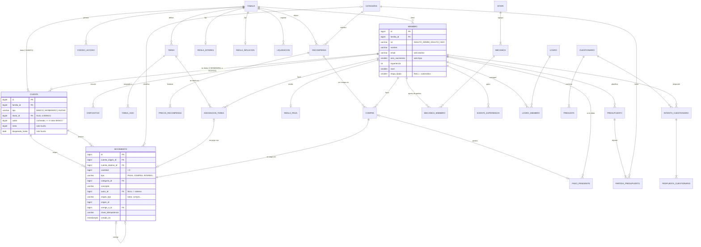

# Modelo de datos

Borrador de la tarea T4 (capítulo 4.2 de la memoria). Concreta la sección 3 del
[diseño](https://claude.ai/artifact/EsiSaFE7YJrWnT6BkFJatm): las tablas del núcleo y de los módulos del
MVP con sus columnas, restricciones y datos iniciales. El esquema completo está en
[`esquema.sql`](esquema.sql) y se ha probado sobre PostgreSQL 16 con
[`pruebas/prueba-libro.sql`](pruebas/prueba-libro.sql).

## 1. Diagrama entidad-relación

## 2. El libro contable: cuenta y movimiento

Es la pieza central y la que sustituye a la blockchain de la propuesta original.

- **Partida doble.** Todo cambio de dinero es un movimiento de una cantidad positiva entre dos
  cuentas de la misma familia. Así el dinero nunca aparece ni desaparece sin rastro.
- **La cuenta BANCO** de cada familia emite el dinero nuevo (recompensas, paga, intereses) y recibe
  el gastado (compras, canjes). Es la única que puede quedar en negativo: su saldo, cambiado de
  signo, es el total de monedas en circulación en la familia, y la suma de todas las cuentas de una
  familia es siempre 0. Esto da una comprobación de integridad gratis.
- **Solo inserción (RNF-09).** Un disparador rechaza cualquier `UPDATE` o `DELETE` sobre
  `movimiento`. Un error se corrige con un movimiento `CORRECCION` enlazado al original.
- **Saldo cacheado y consistente.** Otro disparador actualiza los dos saldos al insertar el
  movimiento, en la misma transacción. El saldo de `cuenta` es un dato derivado del libro y la vista
  `cuenta_cuadre` comprueba que coinciden.
- **Sin saldos negativos (RNF-08)** sin código de bloqueo en Java: el `UPDATE` del disparador bloquea
  las filas de las cuentas (en orden de id, para evitar interbloqueos) y la restricción
  `saldo_no_negativo` rechaza el movimiento que dejaría una cuenta en negativo. Se ha probado
  lanzando dos compras de 20 monedas a la vez sobre un monedero de 30: una se confirma y la otra
  falla, y el libro sigue cuadrando.
- **Idempotencia.** `clave_idempotencia` es única por familia. Si el móvil pierde la respuesta y
  repite la compra con la misma cabecera `Idempotency-Key`, no se cobra dos veces.

> **Decisión de diseño que conviene revisar.** El diseño del 25 de octubre decía que el servicio de
> Java actualiza el saldo. Aquí lo hace la base de datos con disparadores, porque así las reglas del
> dinero se cumplen aunque haya un fallo en el código, y se pueden demostrar con una prueba SQL.
> El coste es que esa lógica está en PL/pgSQL y no en Java. Para un TFG en el que la integridad del
> libro es el argumento principal frente a la blockchain, creo que compensa. En JPA, la columna
> `saldo` se marca como de solo lectura (`insertable = false, updatable = false`) y se refresca tras
> cada movimiento.

## 3. Tablas por módulo

| Módulo | Tablas | Notas |
|---|---|---|
| Familia y acceso | `familia`, `miembro`, `dispositivo`, `codigo_acceso` | Un solo administrador por familia (índice único parcial). El hijo no tiene correo ni contraseña (restricción `hijo_sin_correo`). Los tokens de refresco y los códigos QR se guardan con hash |
| Etapas y mecánicas | `etapa`, `mecanica`, `mecanica_miembro` | Catálogo cargado por migración con las 20 mecánicas de las etapas 1 a 3; `implementada` indica cuáles entran en el MVP |
| Libro contable | `cuenta`, `movimiento`, `categoria` | Ver apartado 2 |
| Reglas automáticas | `regla_paga`, `regla_interes`, `regla_inflacion`, `liquidacion` | `liquidacion` tiene una clave única por tipo, referencia y periodo para que la paga o el interés no se paguen dos veces si el servidor se reinicia |
| Tareas | `plantilla_tarea`, `tarea`, `tarea_hijo`, `asignacion_tarea` | Una asignación por hijo y día. Una asignación APROBADA siempre tiene su movimiento (restricción). Columna `version` para el bloqueo optimista |
| Tienda | `plantilla_recompensa`, `recompensa`, `precio_recompensa`, `compra`, `pago_pendiente` | Los euros se guardan en céntimos. `precio_recompensa` guarda el historial para la inflación y las gráficas |
| Presupuesto | `presupuesto`, `partida_presupuesto` | La semana se identifica por su lunes (restricción). Las marcas de aviso evitan repetir el del 80 % y el del 100 % |
| Progreso | `evento_experiencia`, `logro`, `logro_miembro` | `evento_experiencia` también es de solo inserción y tiene clave única por origen: la misma tarea no da experiencia dos veces |
| Evaluación | `cuestionario`, `pregunta`, `intento_cuestionario`, `respuesta_cuestionario` | Un intento INICIAL y uno FINAL por persona y cuestionario, para medir la mejora (objetivo 6) |

## 4. Reglas de cálculo

| Regla | Definición |
|---|---|
| Etapa | La mayor etapa cuya edad mínima cumple el hijo (por año de nacimiento) **y** cuyo nivel mínimo ha alcanzado, salvo que los padres la fijen (`etapa_fijada`). Sin año de nacimiento, etapa 1 |
| Mecánica desbloqueada | Su etapa ≤ etapa del hijo y su nivel mínimo ≤ nivel del hijo, salvo ajuste de los padres (`ACTIVADA` o `DESACTIVADA`) y siempre que esté implementada |
| Nivel | A partir de la experiencia con una curva creciente, por ejemplo XP necesaria para el nivel n = 50·(n−1)·n/2. Se fija en el backend y se puede recalcular desde `evento_experiencia` |
| Interés simple | `floor(aportado_neto × tipo_pb / 10000)`, donde aportado_neto = saldo − intereses ya recibidos |
| Interés compuesto | `floor(saldo × tipo_pb / 10000)` |
| Inflación | Cada mes, precio nuevo = `ceil(precio × (10000 + tipo_mensual_pb) / 10000)`, guardado en `precio_recompensa` |
| Conversión a euros | céntimos = monedas × 100 / monedas_por_euro; solo se aceptan cantidades que den céntimos exactos |

## 5. Lo que se añadirá después

Cada módulo posterior trae su migración sin tocar las tablas anteriores, salvo ampliar los `CHECK`
de tipos de cuenta y de movimiento:

| Módulo | Tablas previstas | Cambio en el núcleo |
|---|---|---|
| Préstamos | `prestamo`, `oferta_prestamo`, `cuota` | Tipos de movimiento `PRESTAMO` y `CUOTA` |
| Estado familiar | `regla_impuesto`, `propuesta_mejora`, `voto` | Tipo de cuenta `FONDO_COMUN` y movimiento `IMPUESTO` |
| Clan | `evento_muro`, `mensaje`, `participacion` | Tipo de cuenta `MEGAHUCHA` |
| Aprende | `video`, `visualizacion`, `pregunta_video` | Ninguno |
| Personalización | `elemento_perfil`, `elemento_miembro` | Ninguno |
